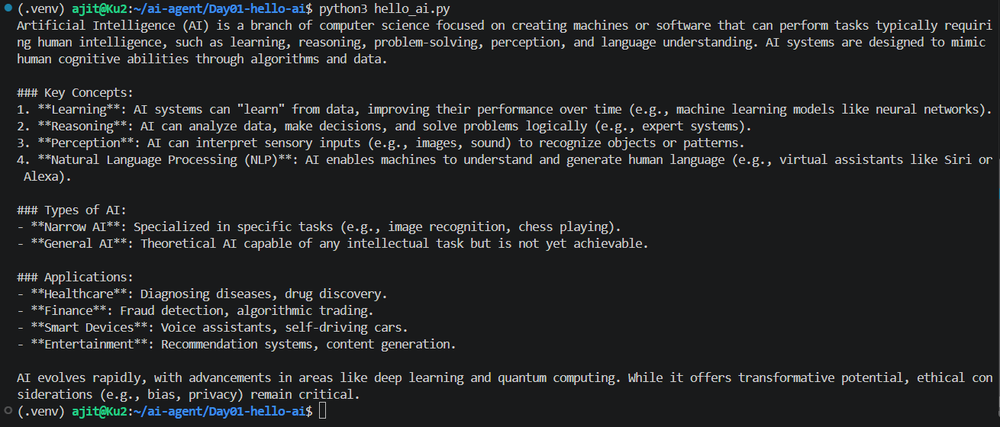
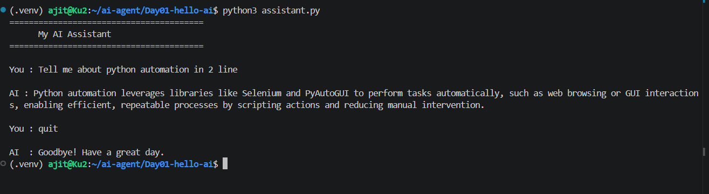

# Day 01: Hello AI

## Goal
Send my first question to a local LLM (Ollama, `qwen3:1.7b`) from Python, and see it answer both from a script and in an interactive chat.

## What I built
- `hello_ai.py`: loads settings from `.env` and sends a fixed question ("What is Artificial Intelligence?") to Ollama through the OpenAI-compatible API
- An interactive assistant where I type my own question and the model answers (screenshot below)

## Tech used
Python, Ollama, `qwen3:1.7b`, `openai` library, `python-dotenv`, VS Code on WSL (Ubuntu)

## How to run
```bash
# from the repo root
source .venv/bin/activate
pip install -r requirements.txt
cp .env.example Day01-hello-ai/.env

cd Day01-hello-ai
python3 hello_ai.py
```
Make sure Ollama is running first (`ollama serve`, or the Ollama service).

## Output

### 1. Script answering a fixed question


### 2. Asking my own question and getting an answer


## How it works
1. `load_dotenv()` reads `BASE_URL`, `API_KEY` and `MODEL` from `.env`
2. `OpenAI(base_url=..., api_key=...)` creates a client that points to the local Ollama server
3. `client.chat.completions.create(...)` sends the question
4. `response.choices[0].message.content` is the answer

## What I learned
- Ollama exposes an OpenAI-compatible API, so the same code can later switch to other providers
- Keeping configuration in `.env` keeps the code clean and secrets out of Git
- qwen3 models may show a `<think>` section before the answer

## Problems I solved
- sudo password failure and missing `zstd` while installing Ollama on WSL
- Day01 was inside `.venv`; moved it so the environment can be rebuilt without losing work
- Replaced `qwen3:4b` with the lighter `qwen3:1.7b` for faster responses