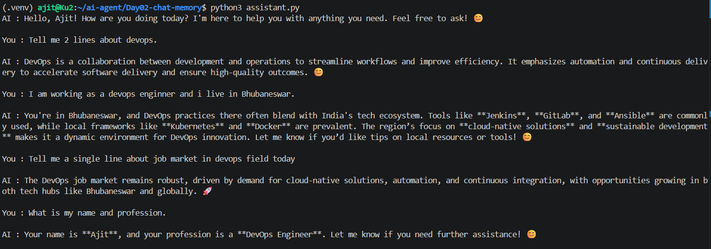

# Day 02: Chat Assistant with Conversation Memory

## Goal
Turn the single question from Day 01 into a terminal chat loop where the AI remembers what was said earlier in the conversation.

## What I built
- `assistant.py`: an interactive terminal chat with a local LLM (Ollama, `qwen3:1.7b`)
- A `messages` list that stores every question and answer, and is sent to the model on each turn, so the model keeps context

## Tech used
Python, Ollama, `qwen3:1.7b`, `openai` library, `python-dotenv`, VS Code on WSL (Ubuntu)

## How to run
```bash
# from the repo root
source .venv/bin/activate
cp .env.example Day02-chat-memory/.env   # skip if .env already exists

cd Day02-chat-memory
python3 assistant.py
```
Make sure Ollama is running first (`ollama serve`, or the Ollama service).

## Output
I told the assistant my profession and city, asked a few unrelated questions, then asked "What is my name and profession?". It answered correctly, which shows the memory works.



## How memory works
The model itself does not remember anything between requests. Memory comes from my code, which keeps the whole conversation in a list and sends it every time (simplified):

```python
messages = [{"role": "system", "content": "You are a helpful assistant."}]

while True:
    user_input = input("You : ")
    messages.append({"role": "user", "content": user_input})

    response = client.chat.completions.create(
        model=os.getenv("MODEL"),
        messages=messages,
    )
    reply = response.choices[0].message.content
    print("AI :", reply)

    messages.append({"role": "assistant", "content": reply})
```

## What I learned
- LLM APIs are stateless: every request must include the earlier messages
- Message roles: `system` (instructions), `user` (my input), `assistant` (model replies)
- Appending both the question and the answer after every turn is what creates memory
- The history grows with every turn, and models have a context limit, so long chats need trimming or summarizing (a topic for later days)

## Problems I solved
- Memory did not work until I appended the assistant's reply to `messages`, not only the user's message

