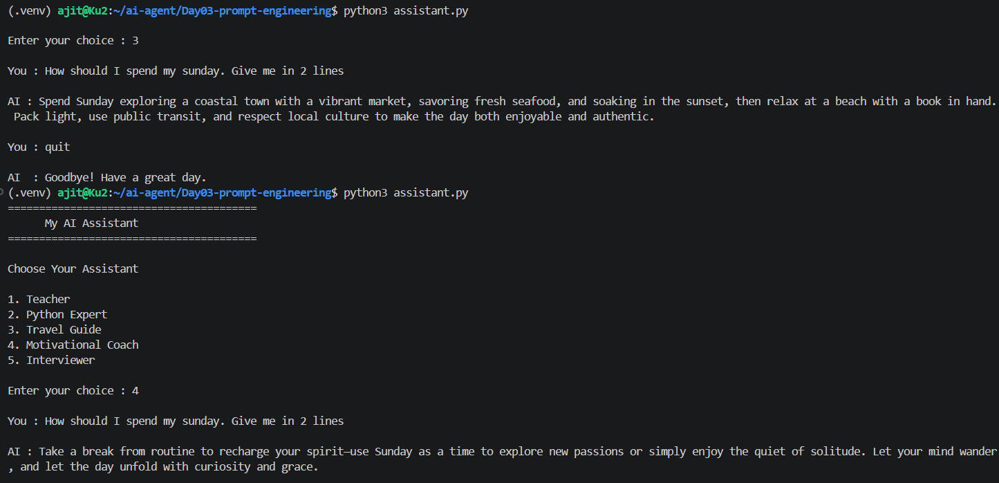

# Day 03: Prompt Engineering with Role-Based Assistants

## Goal
Learn how a **system prompt** changes the behavior, tone and style of an AI model, and build an assistant where the user picks the role.

## What I built
- `assistant.py`: a terminal chat app with a role menu. The chosen role becomes the `system` message, and the conversation history keeps the memory from Day 02.
- 5 roles, each defined by a prompt:

| Choice | Role | Prompt idea |
|--------|------|-------------|
| 1 | Teacher | Simple language and real-life examples |
| 2 | Python Expert | Clear explanations, always with Python examples |
| 3 | Travel Guide | Places, food, transport and travel tips |
| 4 | Motivational Coach | Encouraging, practical advice |
| 5 | Interviewer | One question at a time, feedback after each answer |

## Tech used
Python, Ollama, `qwen3:1.7b`, `openai` library, `python-dotenv`, VS Code on WSL (Ubuntu)

## How to run
```bash
# from the repo root
source .venv/bin/activate
cd Day03-prompt-engineering
python3 assistant.py
```
Make sure Ollama is running first. Type `quit` to exit. This folder needs its own `.env` (copy `.env.example`).

## Output
Same question ("How should I spend my Sunday? Give me in 2 lines") asked to two different roles:



- **Travel Guide** suggested a coastal town, local food and travel tips
- **Motivational Coach** suggested recharging, new passions and a positive mindset

## How it works
```python
messages = [{"role": "system", "content": roles.get(choice, "You are a helpful AI assistant.")}]
```
1. The user picks a role, and its prompt is stored as the first `system` message
2. Every user question and AI reply is appended to `messages`, so the model keeps context
3. The full list is sent on each request, so the role applies to the whole conversation
4. If the user enters an invalid choice, a default helpful-assistant prompt is used

## What I learned
- A system prompt sets the role, tone and rules without changing the user's question
- The same question gives very different answers depending on the role
- Clear, specific role prompts (who the model is + what it should do) work better than vague ones
- The model does not remember anything by itself. My code sends the system prompt and history every time.
- Small local models follow roles reasonably well, but may ignore length limits like "in 2 lines"

