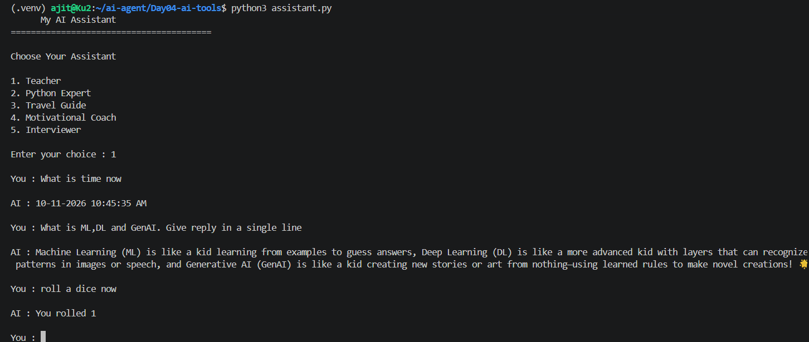

# Day 04: AI Assistant with Tools

## Goal
Give the assistant abilities that a language model cannot do reliably on its own, such as telling the real current time, rolling a dice and generating a secure password, by running normal Python functions ("tools").

## What I built
A modular assistant split into three files:

| File | Responsibility |
|------|----------------|
| `tools.py` | The tools: `get_current_time()`, `roll_dice()`, `generate_password()` |
| `tool_manager.py` | `execute_tool(user_input)` checks the message and decides whether a tool should run |
| `assistant.py` | The chat loop with role menu and memory (Day 02 and 03). Tools are checked first, and everything else goes to the LLM |

## Tech used
Python, Ollama, `qwen3:1.7b`, `openai` library, `python-dotenv`, `datetime`, `random`, `secrets`, VS Code on WSL (Ubuntu)

## How to run
```bash
# from the repo root
source .venv/bin/activate
cd Day04-ai-tools
python3 assistant.py
```
Make sure Ollama is running first. This folder needs its own `.env` (copy `.env.example`). Type `quit` to exit.

Try:
- `What is time now`
- `roll a dice now`
- `give me a password`
- any normal question, for example `What is ML, DL and GenAI?`

## Output


- "What is time now" returned the real system time from Python
- "roll a dice now" returned a random number from Python
- "What is ML, DL and GenAI" went to the LLM, which answered in the chosen Teacher role

## How it works
```
User message
     |
execute_tool()  -- keyword found? --> run the Python tool --> print result
     |
     no tool needed
     |
send messages (with history) to the LLM --> print reply
```
The `secrets` module is used for passwords because it is designed for security, unlike `random`.

## What I learned
- LLMs cannot know the current time or produce true random values, so real code should do that work
- Separating tools, tool routing and chat logic into files keeps the project easy to extend
- `secrets` is the right choice for passwords; `random` is not secure
- Tools are the first step toward agents: the assistant now acts, not just talks

## Limitations 
- Routing is keyword-based, so it can misfire. For example, "How do I reset my password?" would generate a password, and a sentence containing "sometimes" would match "time".
- Tool results are printed but not added to the conversation history, so the model does not know a tool was used.
- The program, not the model, decides when to call a tool. In real function calling, the model chooses the tool.

The limitations will overcome in upcoming days.
