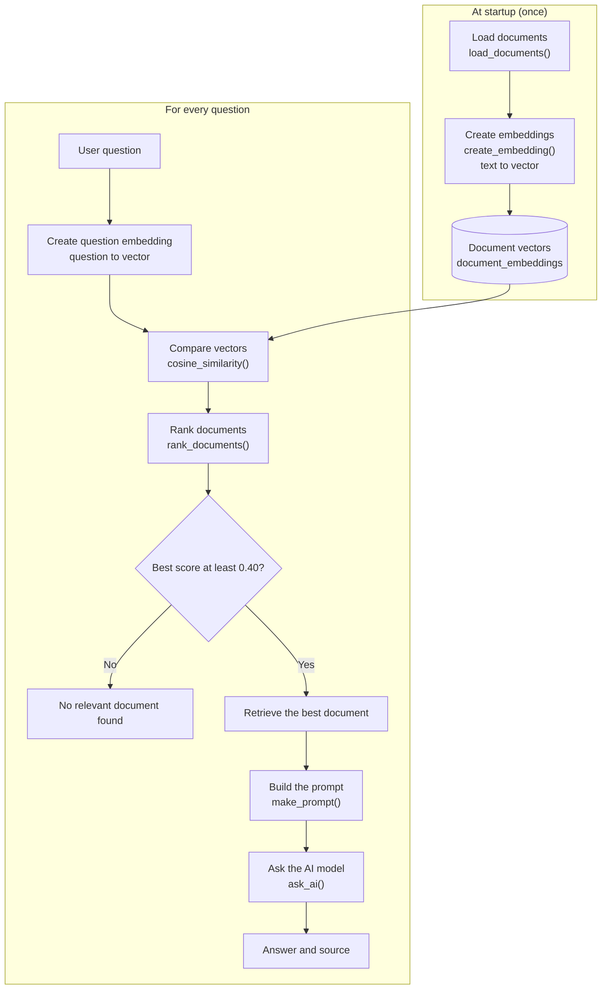
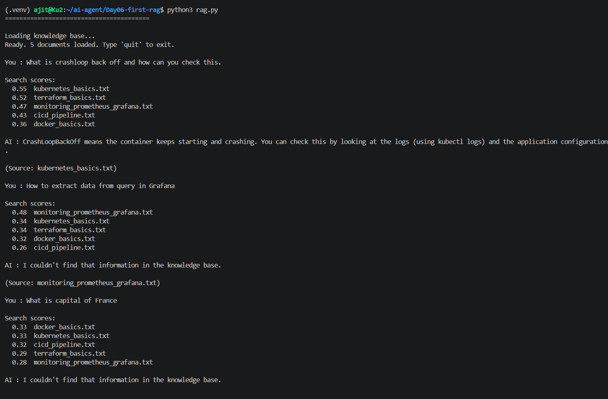
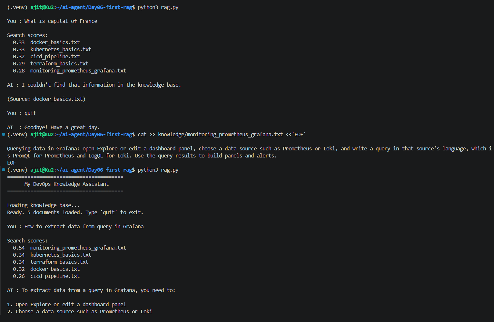
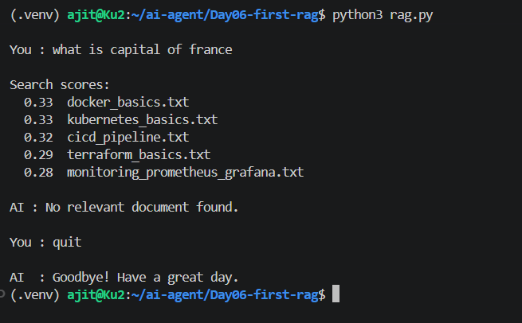
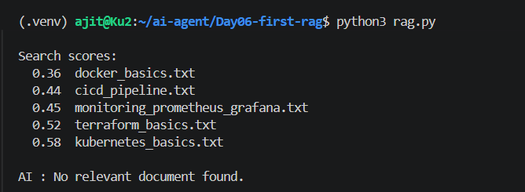

# Day 06: First RAG System (DevOps Knowledge Assistant)

## Goal
Let the assistant find the right document by itself and answer from it, instead of me naming the file like in Day 05. This is my first RAG (Retrieval-Augmented Generation) system.

## What I built
| File | Responsibility |
|------|----------------|
| `tools.py` | `load_documents()`, `create_embedding()`, `cosine_similarity()`, `rank_documents()`, `make_prompt()`, `ask_ai()` |
| `rag.py` | The chat loop: embeds the documents at startup, then searches and answers each question |
| `knowledge/` | My own DevOps knowledge base: Kubernetes, Docker, CI/CD, Terraform, Prometheus and Grafana (one `.txt` file each) |

## Tech used
Python, Ollama, a Qwen3 chat model (set in `.env`) for answers, `nomic-embed-text` for embeddings, `openai` library, `python-dotenv`, VS Code on WSL (Ubuntu)

## How to run
```bash
# from the repo root
source .venv/bin/activate
ollama pull nomic-embed-text
cd Day06-first-rag
cp ../Day05-ai-document/.env .env   # skip if .env already exists
python3 rag.py
```
Make sure Ollama is running first. Type `quit` to exit.

Try:
- `What does CrashLoopBackOff mean?`
- `How can I make a Docker image smaller?`
- `What is terraform plan used for?`
- `What is the capital of France?` (should be rejected)

## How it works



1. **Load:** read every `.txt` file in `knowledge/`
2. **Embed:** turn each document into a vector (a list of numbers that represents its meaning). Done once at startup.
3. **Ask:** turn the question into a vector in the same way
4. **Compare:** score the question against every document with cosine similarity
5. **Retrieve:** take the best-scoring document (or stop if the score is too low)
6. **Prompt:** put that document and the question into one prompt, with the rule "answer only from the context"
7. **Generate:** the chat model writes the answer, and the program prints the source file

## Key concepts
| Term | Meaning in this project |
|------|--------------------------|
| Embedding / vector | A list of numbers that captures the meaning of a text |
| Cosine similarity | A score for how close two vectors are (closer to 1 means more similar) |
| Vector store | Here just a dictionary in memory (`document_embeddings`). Real systems use a vector database (later days) |
| Retrieval | Finding the most relevant document for the question |
| Generation | The chat model writing the answer from the retrieved text |

Two models, two jobs: `nomic-embed-text` finds, and the chat model explains.

## Output

**1. First run: related questions are answered, and an unrelated one is not**



**2. Knowledge missing, then added.** The Grafana question first got "I couldn't find that information". After I added one paragraph to the knowledge file (no code change), the same question was answered.



**3. Minimum score limit.** "What is capital of France" scored about 0.33, below my 0.40 limit, so no document was sent to the model.



**4. Debugging a silent bug.** After changing `scores.sort(reverse=True)` to `scores.sort()`, the scores were in ascending order, so the "best" match was the lowest score (0.36) and a good question got "No relevant document found". There was no error message.



## What I changed and tried
- Added a Grafana querying paragraph to a knowledge file: the question was answered with no code change, so knowledge is added by adding files
- Added a minimum score of 0.40, chosen from the scores I observed (related questions scored 0.48 or more, the unrelated one about 0.33)

## Debugging practice
| Drill | What I broke | What I learned |
|-------|--------------|----------------|
| 1 | Wrong embedding model name in `.env` | Read the last line of the error: the model name was wrong |
| 2 | Renamed the `knowledge` folder | A clear check in code gives a friendly message instead of a crash |
| 3 | Removed `reverse=True` from the sort | Bugs without errors are found by looking at the middle values (the printed scores) |
| 4 | Wrong chat model name | Scores printed, then an error: retrieval worked, generation failed |

## What I learned
- RAG has three parts: retrieve, add to the prompt, generate
- The model only answers from the text it is given, so a good "use only the context" rule prevents made-up answers
- If the answer is not in the knowledge base, the model cannot find it, so knowledge quality matters as much as code
- The search always picks a winner, even when nothing is relevant, so a minimum score is needed
- Printing intermediate values (the scores) and using breakpoints are how I find bugs that show no error

## Limitations (honest notes)
- The whole document becomes one embedding, so topics blend and scores are close (for example Kubernetes 0.55 vs Terraform 0.52 for a Kubernetes question). Chunking will improve this.
- Only one document is used per question, so an answer that spans two files is incomplete
- Embeddings are recreated every time the program starts, which is fine for five small files
- The 0.40 limit comes from a handful of test questions, so it needs more testing

## Problems I solved
- The silent sorting bug (see screenshot 4), found by reading the scores and stepping through debugger
- "Couldn't find that information" for a Grafana question: the answer was missing from the knowledge base, not a code bug

## Next
Day 07: my first AI agent, where the model decides which tool to use.
