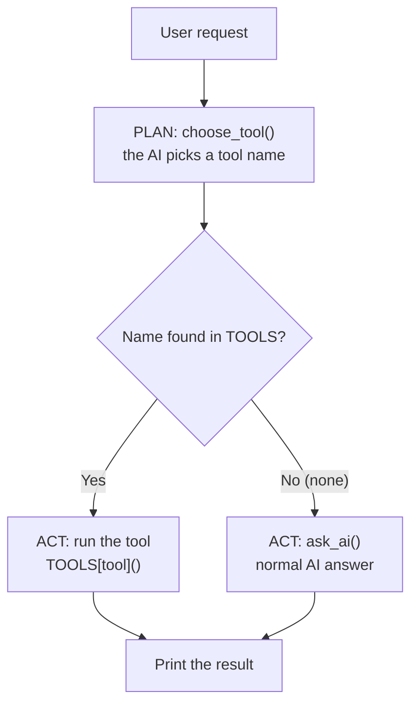
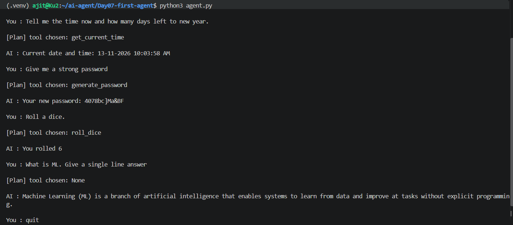

# Day 07: First AI Agent (Plan, then Act)

## Goal
Build my first AI agent: the model decides which tool is needed, and Python runs it. In Day 04 I chose the tool myself. Here the AI chooses.

## What I built
| File | Responsibility |
|------|----------------|
| `tools.py` | The tools (`get_current_time()`, `roll_dice()`, `generate_password()`), the `TOOLS` dictionary, the planner `choose_tool()` and `ask_ai()` |
| `agent.py` | The chat loop: plan (choose a tool), then act (run it, or just answer) |

## Tech used
Python, Ollama, a Qwen3 chat model (set in `.env`), `openai` library, `python-dotenv`, VS Code on WSL (Ubuntu)

## How to run
```bash
# from the repo root
source .venv/bin/activate
cd Day07-first-agent
cp ../Day06-first-rag/.env .env   # skip if .env already exists
python3 agent.py
```
Make sure Ollama is running first. Type `quit` to exit.

Try:
- `What is the time now?`
- `Roll a dice.`
- `Give me a strong password`
- `What is ML. Give a single line answer` (no tool, normal answer)

## How it works



1. **Read:** `agent.py` reads what I type
2. **Plan:** `choose_tool()` sends the request to the model with a short planner prompt. The model must reply with only a tool name, or `none`
3. **Clean:** the reply is cleaned (the `<think>` part removed, spaces stripped, lower-cased)
4. **Match:** the loop `for name in TOOLS` checks whether a known tool name is inside the reply
5. **Act:** if a name matches, `TOOLS[tool]()` runs that Python function. If not, `ask_ai()` answers the question
6. **Print:** the result is shown, and the `[Plan]` line shows which tool was chosen

The tools contain no AI. The AI only chooses, and normal Python does the work.

## Key concepts
| Term | Meaning in this project |
|------|--------------------------|
| Agent | A program where the model decides what to do next, and code carries it out |
| Planner | The model call (`choose_tool`) that returns a tool name |
| Tool | A normal Python function the agent can run |
| `TOOLS` dictionary | Maps a tool name (text) to its function, so the planner's reply can find the function |
| Plan, then Act | The two steps of every request in this agent |

## Output

**1. Four requests: three tools and one normal answer**



**2. Limitation: two jobs in one request.** "Tell me the time now and how many days left to new year" ran only `get_current_time`. The agent chooses one tool per request, so the second part was ignored.

## Debugging practice
| Drill | What I broke | What I learned |
|-------|--------------|----------------|
| 1 | Typo in the planner prompt (`roll_dices`) | Model output is not always exact. `in` is a substring check, so it still matched `roll_dice`. An exact check (`==`) would have returned `None` |
| 2 | Changed `range(length)` to `range(length - 1)` | A bug can have no error. Compare the actual value (`len(password)` = 11) with the expected one (12), then move the breakpoint earlier to find the cause |
| 3 | Looked at `tool` while paused inside `choose_tool` | `NameError` is expected: `tool` exists only in `agent.py`. A function cannot see its caller's variables (scope) |

## What I learned
- An agent is a loop of plan, then act. The model decides, the code does
- The planner's reply must be cleaned and checked, because the model can add extra text or small typos
- A `TOOLS` dictionary connects the planner's answer (text) to a real function
- Printing the `[Plan]` line makes the agent's decision visible, which helps debugging
- Bugs without errors are found by comparing actual values with expected values in the debugger

## Limitations (honest notes)
- One tool per request. Multi-step requests need planning, which comes in later days
- Tools take no arguments, so the password length is always 12 and the dice always has 6 sides
- The planner depends on a small model (`qwen3:4b`), so it can pick the wrong tool for unusual wording
- `if name in reply` is forgiving but can match a reply that only mentions a tool name, for example "not roll_dice"
- No conversation memory in this agent. Each request is handled on its own

## Next
Day 08: MCP, connecting the agent to external tools and data sources.
