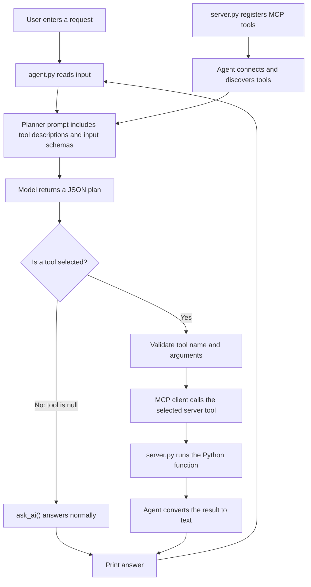
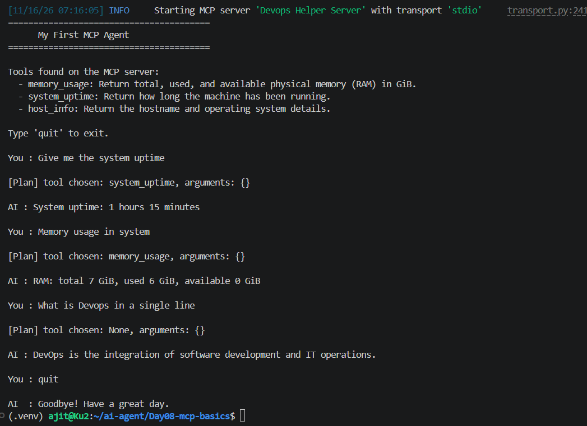

# Day 08: MCP Basics

## Goal

Connect an AI agent to tools hosted by an MCP server. The model chooses a tool, and Python calls it through the Model Context Protocol (MCP).

## What I built

| File | Responsibility |
|------|----------------|
| `server.py` | Creates the MCP server and exposes the `memory_usage()`, `system_uptime()`, and `host_info()` tools |
| `agent.py` | Connects to the MCP server, discovers its tools, asks the model to plan, validates the plan, and calls the selected tool |

## Tech used

Python, FastMCP, Ollama with an OpenAI-compatible API, `openai`, `python-dotenv`, VS Code on WSL (Ubuntu)

## How to run

From the repository root:

```bash
source .venv/bin/activate
cd Day08-mcp-basics
cp ../.env.example .env  # only needed the first time
python3 agent.py
```

Make sure Ollama is running and the model in `.env` is available. The MCP client starts `server.py` when the agent connects, so run `agent.py` rather than starting the server separately. Type `quit` to exit.

Try:

- `How long has this machine been running?`
- `Tell me the total and available RAM`
- `What are this machine's hostname and operating system?`

The server currently exposes those three tools. A request such as `Is port 8080 open on localhost?` has no matching tool; the planner may return `null`, and the agent will ask the model for a normal answer instead.

## How it works



1. **Connect:** `Client(Path(__file__).resolve().with_name("server.py"))` connects the agent to the local MCP server.
2. **Discover:** `mcp.list_tools()` gets the tools and their input schemas from the server.
3. **Plan:** `choose_tool()` sends the user request and available tools to the model. The model is asked to return JSON containing a tool name and arguments, or `null` when no tool is needed.
4. **Validate:** the agent parses the JSON, checks that the tool exists, confirms the arguments are an object, and rejects argument names the tool does not support.
5. **Act:** if a tool was selected, `mcp.call_tool()` sends it and its arguments to the server. Otherwise, `ask_ai()` answers without a tool.
6. **Show:** `result_to_text()` extracts text from the MCP result, and the agent prints it.

The MCP server does the actual system-information work. The model only chooses which available tool to call; it does not read the machine's RAM or uptime itself.

## Output



- The agent discovers and lists the three tools exposed by the MCP server.
- Requests about uptime and memory are handled by their respective MCP tools.
- A general DevOps question receives a normal AI answer because it does not need a tool.

## Key concepts

| Term | Meaning in this project |
|------|--------------------------|
| MCP server | `server.py`, which advertises tools and runs them when called |
| MCP client | The `Client` in `agent.py`, which connects to the server |
| Tool discovery | Asking the server for its available tools and input schemas |
| Input schema | Describes the arguments a tool accepts |
| Plan, then act | The model selects a tool and Python carries out the call |

## Limitations

- The agent can call only the tools currently registered in `server.py`.
- It selects at most one tool for each request; it does not plan multi-tool workflows.
- The planner must return valid plain JSON. Extra prose or Markdown code fences cause JSON parsing to fail.
- `memory_usage()` and `system_uptime()` read Linux `/proc` files, so they are Linux-specific. In a container or VM, reported resources may reflect that environment rather than the physical host.
- Requests are independent; the agent does not keep conversation memory.
