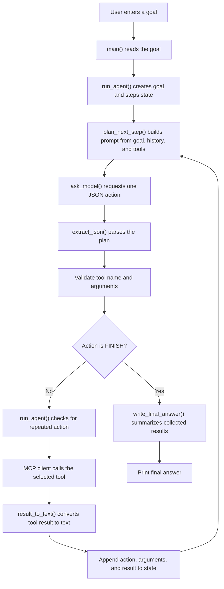
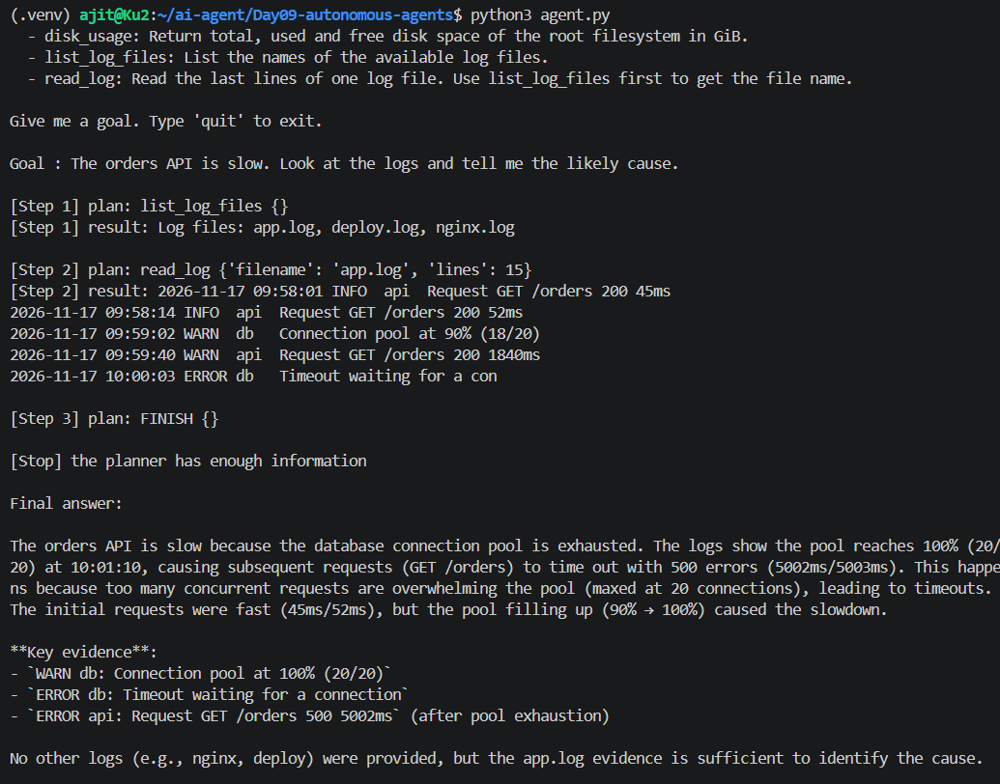

# Day 09: Autonomous Agents

## Goal

Build an agent that can plan and execute a short sequence of MCP tool calls. The model chooses one next action at a time, while Python validates and runs each tool, records its result, and gives that history to the planner on the next iteration.

## What I built

| File | Responsibility |
|------|----------------|
| `agent.py` | Connects to the MCP server, accepts a goal, runs the plan/act/remember loop, and prints the final answer |
| `planner.py` | Describes tools and prior steps to the model, parses and validates each JSON plan, and writes the final answer |
| `server.py` | Exposes read-only disk-usage and log-file tools through FastMCP |
| `logs/` | Sample application, deployment, and Nginx logs for trying log-analysis goals |

## Tech used

Python, FastMCP, Ollama with an OpenAI-compatible API, `openai`, `python-dotenv`, VS Code

## Setup and run

From the repository root, create and activate the environment and install dependencies if you have not already:

```bash
python3 -m venv .venv
source .venv/bin/activate
pip install -r requirements.txt
```

Create a Day 09 environment file from the example if needed:

```bash
cp .env.example Day09-autonomous-agents/.env
```

Make sure Ollama is running and the model configured in `Day09-autonomous-agents/.env` is available. Then run the agent from its folder:

```bash
cd Day09-autonomous-agents
python3 agent.py
```

The MCP client starts `server.py` when it connects; run `agent.py`, not the server separately. Type `quit` to exit.

## Try it

- `How much free disk space is available?`
- `The orders API is slow. Look at the logs and tell me the likely cause.`
- `Show me the last 5 lines of deploy.log.`

The sample logs include application database-pool timeouts and Nginx upstream timeouts. `read_log` reads only files under `logs/` and limits output to at most 50 lines.

## How it works



1. **Connect and discover:** `main()` connects to the MCP server and lists its tools and input schemas.
2. **Plan:** `run_agent()` calls `plan_next_step()`. The planner includes the goal, previous results, and available tools in its prompt. The model returns one JSON action and its arguments, or `FINISH`.
3. **Validate:** the planner checks that the action names a discovered tool, that arguments form an object, and that no unsupported argument names are supplied.
4. **Act:** unless the planner selected `FINISH` or repeated an earlier action, `run_agent()` calls the tool through MCP.
5. **Remember:** `result_to_text()` extracts text from the MCP response, and the agent saves the action, arguments, and result in `state["steps"]`. The next planning prompt includes this history.
6. **Answer:** when the planner selects `FINISH` or the loop reaches its limit, `write_final_answer()` asks the model to answer using only the collected results.

## Tools

| Tool | Purpose |
|------|---------|
| `disk_usage()` | Reports total, used, and free space on the root filesystem |
| `list_log_files()` | Lists `.log` files in the local `logs/` folder |
| `read_log(filename, lines=15)` | Reads the last requested lines of a log file, with the line count capped at 50 |

## Key concepts

| Term | Meaning in this project |
|------|--------------------------|
| Planner | The model-driven function that chooses one next action from the available tools |
| Agent state | The user's goal and the list of tool calls and results collected so far |
| Plan, act, remember | The repeated cycle of choosing a tool, running it, and saving its result |
| `FINISH` | The planner's signal that it has enough information to answer |

## Limitations

- The agent makes at most three planning iterations per goal.
- It can only use the tools currently registered in `server.py`; it does not execute arbitrary commands or modify system state.
- Tool output is limited to 1,500 characters before it is added to the agent's state.
- The planner must return a JSON object in the expected format. Invalid JSON, unknown tools, or unsupported arguments raise an error.
- The agent does not retain conversation history between goals.

## Demo


