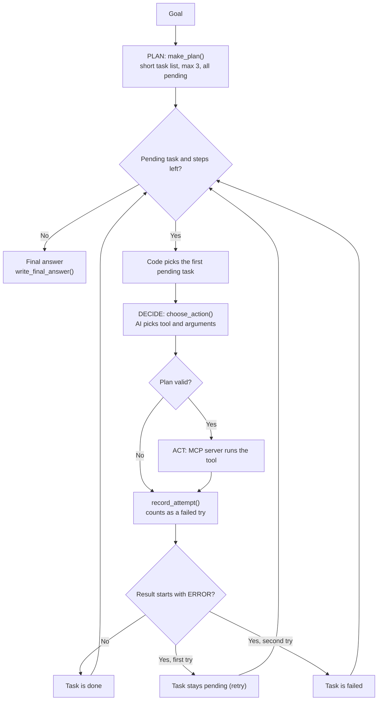
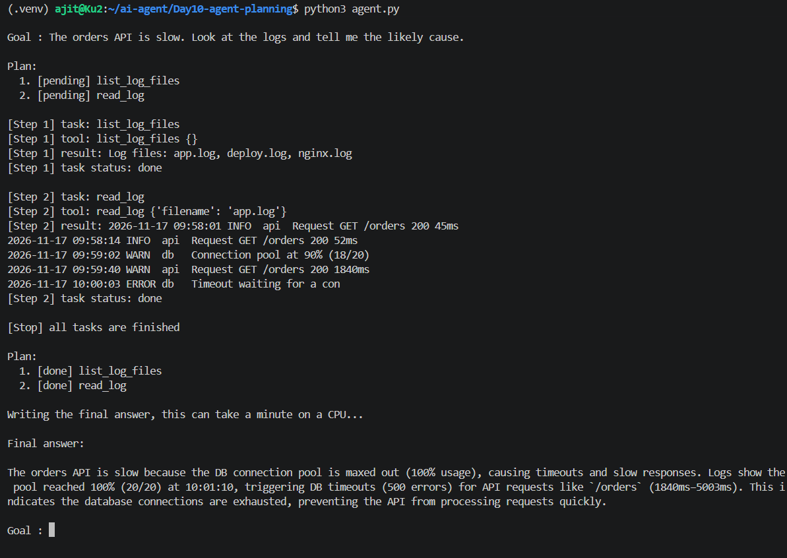
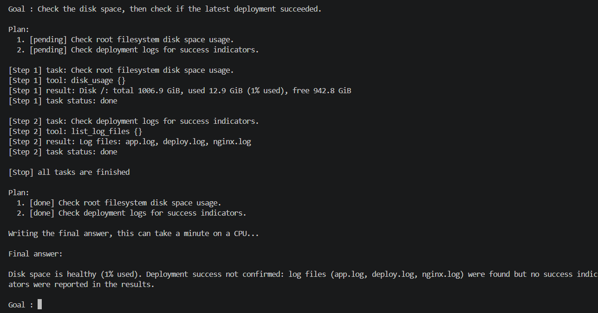

# Day 10: Agent Planning (Plan First, Then Execute)

## Goal
Move from an agent that picks one step at a time (Day 09) to an agent that writes a plan first, tracks the status of every task, and works through the plan. It uses read-only DevOps tools through an MCP server.

## What I built
| File | Responsibility |
|------|----------------|
| `server.py` | MCP server with three read-only DevOps tools: `disk_usage`, `list_log_files`, `read_log`. A failed tool returns text starting with `ERROR` |
| `planner.py` | Every AI call: `make_plan()` writes the task list, `choose_action()` picks a tool and its arguments for one task, `write_final_answer()` writes the answer |
| `agent.py` | The state, the loop, the retry rule and the MCP connection |
| `logs/` | Fictional sample logs: `app.log`, `nginx.log`, `deploy.log` |

## Tech used
Python, FastMCP, Ollama (Qwen3 chat model set in `.env`), `openai` library, `python-dotenv`, VS Code on WSL (Ubuntu)

## How to run
```bash
# from the repo root
source .venv/bin/activate
cd Day10-agent-planning
cp ../.env.example .env   # first time only, then set MODEL in .env
python3 agent.py
```
Make sure Ollama is running. The agent starts `server.py` by itself. Type one goal at a time, and `quit` to exit. On a CPU, a run can take several minutes, because it makes about five model calls.

Goals to try:
- `The orders API is slow. Look at the logs and tell me the likely cause.`
- `Check the disk space, then check if the latest deployment succeeded.`
- `Read payments.log and tell me what errors it shows.` (the file does not exist, so this shows the retry rule)

## How it works



1. **Plan:** the AI breaks the goal into at most 3 short tasks. They are shown before anything runs.
2. **Pick:** the code takes the first pending task. The AI does not choose the order.
3. **Decide:** the AI chooses the tool and its arguments for that one task, using the results of finished tasks. The plan is validated (known tool, arguments allowed) before it is used.
4. **Act:** the MCP server runs the tool.
5. **Update:** success marks the task done. An error leaves it pending for one retry, and a second error marks it failed.
6. **Answer:** the AI writes a short answer from the finished plan, using only the results.

The limits are 3 tasks and 4 steps, so there is one spare step for a retry.

## What changed from Day 09
| | Day 09 | Day 10 |
|--|--------|--------|
| Plan | None, one step at a time | Written first and shown |
| Who picks the next step | The AI | The code (first pending task) |
| Tracking | List of steps done | Each task has a status: pending, done or failed |
| After an error | Just another result | One retry, then failed |

## Key concepts
| Term | Meaning in this project |
|------|--------------------------|
| Plan | The short task list written before any tool runs |
| Task | One item of the plan, with a status, a try count and a result |
| State | The agent's notebook: the goal and the list of tasks |
| Decide | Choosing a tool and arguments for one task, using earlier results |
| Retry rule | A failed task is tried once more, then marked failed |
| Step limit | A hard stop in code, so the agent cannot run forever |

## Output

**1. Plan, then execute.** The agent listed the log files, then used that result to read `app.log`. The conclusion (the database connection pool was exhausted) matches the evidence in the log.



**2. Tasks written as plain sentences, and a limit of this design.** The disk task worked. For the deployment task, the AI chose `list_log_files` (names only) instead of reading `deploy.log`. The task was still marked done, so the final answer says deployment success is not confirmed.



## What I changed and tried
- Changed the planning rule so tasks are written as plain sentences and not as tool names (compare the plans in the two screenshots)

## What I learned
- A plan written before the work makes an agent easier to read, review and control
- Planning what to do is separate from deciding how to do it: arguments such as a file name depend on earlier results, so the tool is chosen per task
- Rules that must hold (task order, retry count, step limit) belong in code, not only in a prompt
- Errors need a clear marker (`ERROR`), so a check cannot be fooled by normal text
- An answer from a model must be checked against the source: in the first run the answer mixed up the order of two events from `app.log`

## Limitations (honest notes)
- "Done" means the tool call did not fail, not that the task was achieved (see screenshot 2)
- The plan is fixed after the first step, so there is no re-planning when the situation changes
- A small model writes uneven plans, and two runs of the same goal can differ
- On a CPU, every model call is slow, and a run takes minutes
- All tools are read-only on purpose. An agent that changes things needs a human to approve the plan first

## Problems I solved
- **Slow runs:** `ollama ps` showed the model running at 100% CPU (no GPU), and `top` showed about 600% CPU, so the wait was computation and not a freeze. WSL also had only 7.8 GB of RAM, so I raised the limit to about 10 GB in `.wslconfig`.
- **`ModuleNotFoundError: No module named 'fastmcp'`:** the virtual environment was not active after restarting WSL. Fixed with `source .venv/bin/activate`.
- **A task marked done with the wrong tool:** found from the printed steps (screenshot 2) and recorded as a limitation, with a fix to try next

## Next
Day 11: memory engineering, so the agent can remember across steps and conversations.
